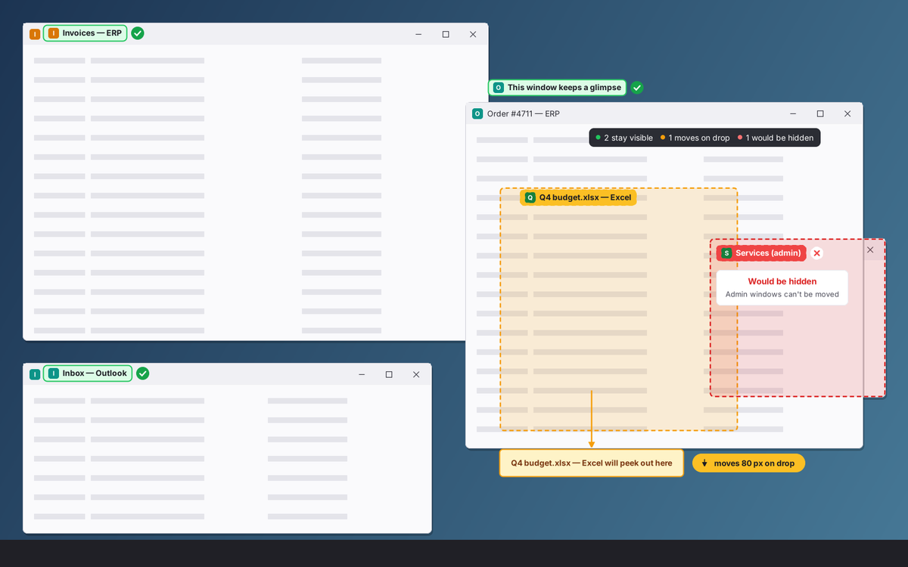
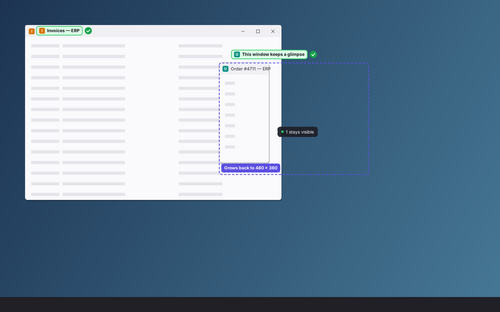
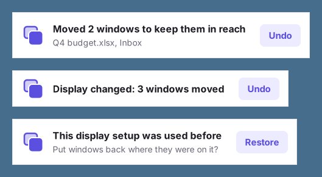
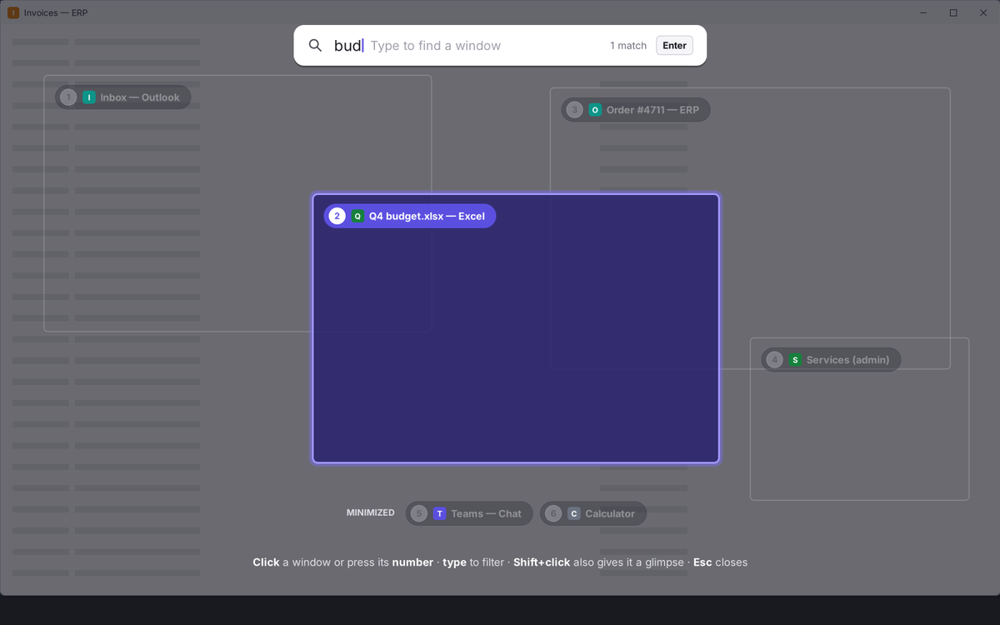
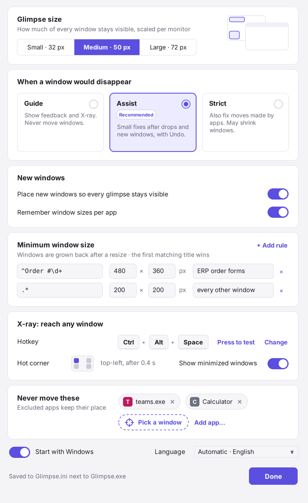
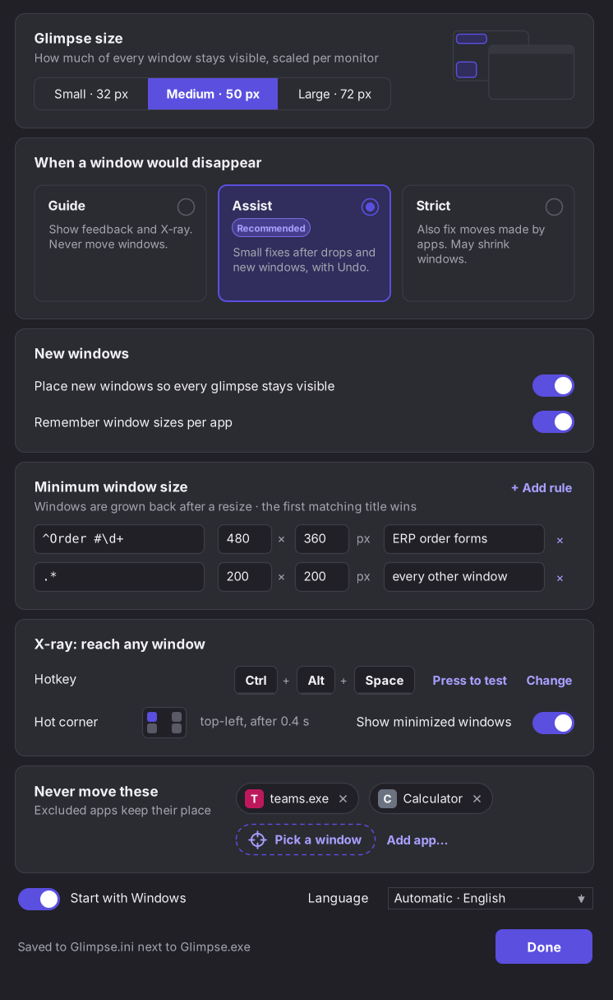

# Glimpse: keep every window within reach

Glimpse (WinGlimpse) makes sure that every open window keeps a **glimpse zone**: a corner or edge
strip at least 50 px wide that no other window overlaps. Every window stays one click away, also
inside RDP and Citrix sessions, where Alt+Tab usually reaches the local PC instead of the session.

- **One rule, independent of stacking order.** The glimpse must lie over the desktop, not over
  another window, so it stays visible whichever window you click. Clicking around never breaks the
  rule; only moving, resizing, opening windows and display changes can.
- **You see it while you drag.** Every other window's glimpse gets a label: green stays visible,
  amber will be nudged on drop, red would be hidden. A chip next to the cursor sums it up, and dashed
  guides show where an edge just clears a neighbour's glimpse (a drop within 12 px snaps to it).
  Hold Shift while dropping to skip the fix.
- **Small automatic fixes.** After a drop or when a window opens, Glimpse restores the rule with
  the smallest move. New windows yield first; windows you placed by hand stay put. Moved windows
  flash, every fix can be undone, and automatic moves can be switched off (Guide mode, Pause).
- **A minimum size.** Windows whose title matches a pattern never stay smaller than their minimum,
  200 × 200 px by default; Glimpse grows them back after a resize.
- **X-ray when the rule cannot hold.** For maximized windows, crowded screens and admin windows,
  Ctrl+Alt+Space, a hot corner or the tray icon shows the outline and name of every window through
  whatever covers it. Click it, press its number or type part of its title.
- **Follows display changes.** After a change in monitors, resolution, scaling or an RDP reconnect,
  off-screen windows are rescued, glimpses are rescaled and both rules are checked again. A display
  setup that returns can get its window positions back.
- **Nothing to install.** One C# file (`Glimpse.cs`, C# 5) runs as `Glimpse.exe` on the .NET
  Framework that ships with Windows, or as `Glimpse.ps1` through `Add-Type`. An optional native
  build (C++, [`src/`](src)) does the same without .NET. Settings live in `Glimpse.ini` next to the
  program. No admin rights, service, driver, DLL injection or keyboard hook.

## Download

Ready-made packages are in [`dist/`](dist):

| Package | Contents | Runs on |
|---|---|---|
| [`Glimpse-1.0.0-win-x64.zip`](dist/Glimpse-1.0.0-win-x64.zip) | `Glimpse.exe` (x64), `Glimpse.ini`, `lang\`, logon script | Windows 10/11 and Server 2019–2025 on x64 (.NET Framework 4.7.2 or later) |
| [`Glimpse-1.0.0-win-arm64.zip`](dist/Glimpse-1.0.0-win-arm64.zip) | `Glimpse.exe` (ARM64) and the same files | Windows 11 22H2+ / Server 2025 on ARM64 (.NET Framework 4.8.1) |
| [`Glimpse-1.0.0-ps1.zip`](dist/Glimpse-1.0.0-ps1.zip) | `Glimpse.ps1` + `Glimpse.cs`, `Glimpse.ini`, `lang\`, logon script, and `build.cmd` with the manifest and icon to compile `Glimpse.exe` on the server | any architecture, Windows PowerShell 5.1 in Full Language mode |
| [`Glimpse-1.0.0-native-win-x64.zip`](dist/Glimpse-1.0.0-native-win-x64.zip) | native `Glimpse.exe` (C++, x64) and the same files as the x64 package | Windows 10/11 and Server 2019–2025 on x64, no .NET needed |
| [`Glimpse-1.0.0-native-win-arm64.zip`](dist/Glimpse-1.0.0-native-win-arm64.zip) | native `Glimpse.exe` (C++, ARM64) and the same files | Windows 11 and Server 2025 on ARM64, no .NET needed |

The C# and native builds behave the same and share `Glimpse.ini`, `lang\`, the log and the
size memory, so either can replace the other. The native build loads no .NET runtime: it starts
faster and needs less memory per session, which adds up on a server with many sessions.

[`dist/SHA256SUMS.txt`](dist/SHA256SUMS.txt) lists the hashes of the zips and the EXEs, for
AppLocker or WDAC hash rules. The EXEs are not signed yet; a copy downloaded from the web carries
the internet-zone mark (file Properties → Unblock).

## Quick start

1. Unzip a package into a folder you can write to, for example `%LOCALAPPDATA%\Glimpse`.
2. Run `Glimpse.exe` (or, for the PowerShell build,
   `powershell.exe -NoProfile -ExecutionPolicy Bypass -WindowStyle Hidden -File Glimpse.ps1 -Background`;
   with `-Background` the script moves itself into a `powershell.exe` without a console window, so no
   window stays open, also where Windows Terminal is the default terminal).
3. Glimpse lives in the notification area. **Left-click** the icon for X-ray, **right-click** for
   the menu: X-ray, Arrange now, Undo last fix, Pause (15 min, 1 h, until tomorrow), Settings, Exit.

Start Glimpse again to open Settings. "Start with Windows" is optional and off by default; when you
turn it on, Glimpse registers itself for your user only (under
`HKCU\Software\Microsoft\Windows\CurrentVersion\Run`, with `/background` and any `/ini:` you used).

## How it works

### The rule

A window is safe when a part of it at least P × P px lies over the desktop rather than over another
window (P = 50 px at 100% scaling, 75 px at 150%). That part stays visible whichever window is in
front. A glimpse must be inside a monitor's work area (not under the taskbar), and it never counts on
the caption buttons. Glimpse prefers the title bar right of the app icon, where a click only
activates the window. It checks this with the window's own hit-test, so browsers and Office with
custom title bars are handled too.

Counted are visible app windows, roughly what Alt+Tab shows: not minimized, not on another virtual
desktop, not tool windows or owned dialogs. Maximized and full-screen windows are exempt ("focus
mode"); the windows behind them stay reachable through X-ray. Always-on-top windows, admin
(elevated) windows, excluded apps and apps that keep moving back are obstacles that are never moved.
Automatic fixes cover the 30 most recently used windows (`MaxWindows`).

### While you drag, after you drop

| | |
|---|---|
|  | While resizing, a dashed outline shows the size the window grows back to (minimum size rule). After the drop, Glimpse nudges each threatened window the shortest distance that frees a glimpse, without taking anyone else's, and shows a toast with **Undo** for 6 seconds. If no small move works (an admin window, a crowded screen), the window is marked reachable through X-ray and counted on the tray icon. |

New, restored and (in Strict mode) app-moved windows yield: they move to the nearest spot where every
glimpse stays, at the same size. Strict mode may also shrink them (70%, then 50%). The last resort is
a cascade offset. With "Remember window sizes per app", a window gets the size you last gave a
window of the same program, class and title shape.

**Never fighting:** Glimpse ignores the events of its own moves for 500 ms, fixes each window at
most once per user action, leaves windows that move back twice within 10 seconds alone, and pauses
automatic fixes for 5 minutes after more than 10 moves within 10 seconds.

### X-ray

Open X-ray with **Ctrl+Alt+Space**, by resting the cursor 0.4 s in the top-left corner of the
desktop, or by clicking the tray icon. Click an outline, press its number, or type part of a title
(case and accents are ignored) and press **Enter**; **Shift+click** also gives the window a glimpse;
**Esc** closes. Minimized windows are listed along the bottom.

Ctrl+Alt+Space is the default because neither the RDP clients nor the Citrix Workspace app reserve
it, and with Space it types no AltGr character. In Settings you can pick Ctrl+Shift+Alt+Space,
Ctrl+Alt+Enter or Pause, or record another combination. Every choice is checked three ways: Windows
accepts the registration, it types no character on any installed keyboard layout, and a **Press to
test** confirms it arrives in the session through your remote client.

### Display changes

Glimpse listens to `WM_DISPLAYCHANGE`, `WM_DPICHANGED`, work-area changes and session notifications
(RDP reconnect, unlock), and compares the monitor layout every 10 seconds as a safety net. Once the
display has been quiet for 1.5 seconds, it rescues off-screen windows (same relative position on the
nearest monitor), rescales the glimpse size, applies minimum sizes and runs the resolver over all
windows. One toast follows: "Display changed: 3 windows moved · Undo". It also remembers window
positions per display setup for the session; when a known setup returns, a toast offers to restore them.

## Settings

| Light | Dark |
|---|---|
|  |  |

The settings window writes to `Glimpse.ini`; Glimpse also reloads the file when you edit it. It
works from the keyboard (Tab, arrow keys, Space; Space cycles the hot corner, Delete removes an
excluded app), and its controls tell screen readers that use MSAA (NVDA, JAWS) their name, role and
state. All options:

| Section, key | Values | Default |
|---|---|---|
| `[Glimpse] Mode` | `Guide` (feedback and X-ray, never moves anything) · `Assist` (fixes after drops and new windows) · `Strict` (also fixes moves made by apps, may shrink) | `Assist` |
| `[Glimpse] GlimpseSize` | px at 100% scaling: 32, 50, 72 or any value 16–400 | `50` |
| `[Glimpse] PlaceNewWindows` | 1 / 0 | `1` |
| `[Glimpse] RememberSizes` | 1 / 0 (sizes go to `%LOCALAPPDATA%\Glimpse\Memory.ini`) | `1` |
| `[Glimpse] MaxWindows` | automatic fixes cover this many recently used windows | `30` |
| `[Glimpse] Language` | `auto` (Windows display language) or `en`, `de`, `cs`, `sk`, any `lang\*.txt` | `auto` |
| `[Glimpse] StartWithWindows` | 1 / 0, optional (HKCU Run entry) | `0` |
| `[Glimpse] LogLevel` | `Info` or `Debug` (Debug also logs window titles) | `Info` |
| `[XRay] Hotkey` | `Ctrl+Alt+Space`, `Ctrl+Shift+Alt+Space`, `Ctrl+Alt+Enter`, `Pause`, any combination, or `Off` | `Ctrl+Alt+Space` |
| `[XRay] HotCorner` | `TopLeft`, `TopRight`, `BottomLeft`, `BottomRight`, `Off` | `TopLeft` |
| `[XRay] ShowMinimized` | 1 / 0 | `1` |
| `[Exclude] ProcessN`, `TitleN` | program file names (`teams.exe`) and title patterns (`^Calculator$`) that are never moved | none |
| `[MinSizeN] TitleRegex`, `MinWidth`, `MinHeight`, `Note` | minimum sizes in px at 100%, scaled per monitor; rules are tried in number order and the first matching title wins | one rule: `.*`, 200 × 200 |
| `[Experimental] FirstClickActivates` | 1: a click on a background window's glimpse only activates it (uses a low-level mouse hook) | `0` |

Title patterns are ECMAScript-style regular expressions and ignore case. An invalid pattern disables
only its own rule; it is logged and the tray shows a warning. The file may be UTF-8 (with or without
BOM) or UTF-16; comments start with `;` or `#` and survive saves.

Saves create a temporary file beside `Glimpse.ini`, then replace the original. The folder must allow
creating files as well as updating the INI. If another program prevents replacement, the save fails
and the original stays intact. Glimpse retries a temporarily locked settings file after it is released;
no further edit is needed.

### Command line

| EXE | PowerShell | |
|---|---|---|
| `/ini:<path>` | `-Ini <path>` | another settings file; environment variables are expanded; a missing file is created from the `Glimpse.ini` next to the program (or the built-in defaults); if the file is not writable, Settings opens read-only |
| `/settings` | `-Settings` | open Settings (also in a Glimpse that already runs) |
| `/exit` | `-Exit` | close the Glimpse that runs in this session |
| `/background` | `-Background` | used at logon: exit quietly when Glimpse already runs |
| `/selftest[:<file>]` | `-SelfTest [-Cases <file>]` | unit tests and the shared geometry cases |
| `/checklang` | `-CheckLang` | missing, obsolete and mismatched keys in `lang\*.txt` |
| `/render:<folder>` | `-Render <folder>` | preview images of the overlays, X-ray, settings and tray menu |

## Deployment on RDP and Citrix servers

Glimpse runs once per user session (a mutex in the session's `Local\` namespace), idles while the
session is locked or disconnected, and needs no admin rights.

- **Each user** runs their own copy, for example in `%LOCALAPPDATA%\Glimpse` with `Glimpse.ini`
  beside it. Settings → Start with Windows (off by default) registers it for that user.
- **For all users at once**, run [`deploy/Start-Glimpse.cmd`](deploy/Start-Glimpse.cmd) as a logon
  script from a share that holds the Glimpse files. It copies `Glimpse.exe` and `lang\` into each
  user's folder when they are missing or differ from the share (compared by content: every file in
  the packages has the same date), never overwrites a user's `Glimpse.ini`, and starts
  Glimpse. Set `GLIMPSE_HOME` for another per-user folder and `GLIMPSE_INI` to pass `/ini:`, for
  example `%APPDATA%\Glimpse\Glimpse.ini` so settings roam with the profile.
  [`deploy/Start-Glimpse-ps1.cmd`](deploy/Start-Glimpse-ps1.cmd) does the same for the PowerShell build.
- **Citrix published desktops** work exactly like RDP sessions. Version 1 is optimized for full
  desktops; published (seamless) apps and RemoteApp are separate windows on the user's PC that a
  session-side tool cannot see.

### Security and policy

- Glimpse uses out-of-context WinEvent hooks (no code runs inside other processes) and `SetWindowPos`
  without activation or z-order changes. It has no keyboard hook and no network access. It writes
  only its settings file, `%LOCALAPPDATA%\Glimpse\Glimpse.log` (rotated at 1 MB) and the size-memory
  file next to the log.
- To bring X-ray or Settings to the front when Windows would refuse (the input that opened them went
  to another window), Glimpse sends one empty mouse input: no movement, no click. Windows only lets
  the program that received the last input take the focus.
- Windows of elevated processes cannot be moved by a non-elevated process; Glimpse compares
  integrity levels and treats them as fixed obstacles.
- Where AppLocker or WDAC enforce rules, allow Glimpse with a path rule for its folder or a hash rule
  per build ([`dist/SHA256SUMS.txt`](dist/SHA256SUMS.txt)). A path rule on a user-writable folder is
  the weaker choice. To compile the EXE on the server from source instead, run `build.cmd` from the
  PowerShell package (it uses the `csc.exe` of the .NET Framework).
- Script rules put PowerShell into Constrained Language Mode, which blocks `Add-Type`; the PowerShell
  build then needs its folder allowed too. An execution policy set by Group Policy overrides
  `-ExecutionPolicy Bypass`.
- Resource use: near-zero idle CPU (no polling except a 100 ms cursor check for the hot corner and a
  10 s safety check); drawing buffers for overlays exist only while an overlay is shown.

## Quick wins without any tool

1. **Send Alt+Tab to the session.** Remote Desktop Connection: Show Options → Local Resources →
   Keyboard → Apply Windows key combinations → "On the remote computer". In `.rdp` files:
   `keyboardhook:i:1`. Citrix Workspace app: `TransparentKeyPassthrough` = `Remote`.
2. **Use the RDP switch keys** in a windowed session: Alt+Page Up / Alt+Page Down act like Alt+Tab
   and Alt+Shift+Tab, Alt+Insert cycles in start order, Alt+Home opens Start.
3. **Add a Task View shortcut** with the target
   `%windir%\explorer.exe shell:::{3080F90E-D7AD-11D9-BD98-0000947B0257}` (check that Task View is
   available on your server build).

## Languages

English is built in and is the fallback for every missing text. `lang\de.txt`, `lang\cs.txt` and
`lang\sk.txt` ship with Glimpse. To add a language, copy [`lang/en.txt`](lang/en.txt) to
`lang\<code>.txt` (for example `pl.txt`), translate the texts and keep the `{placeholders}`; no
rebuild is needed. Plural forms use the CLDR categories `.one`, `.few`, `.many` and `.other`.
`Glimpse.exe /checklang` lists missing and outdated keys. Key names in the hotkey picker come from
Windows, so a German user sees Strg+Alt+Leertaste.

## Building

The program is one file, [`Glimpse.cs`](Glimpse.cs), kept at C# 5 and pure ASCII so the C#
compiler that ships with Windows can build it. The native build in [`src/`](src) is the same
design in C++17 with Win32, GDI+ and DWM; its geometry engine and resolver are a line-by-line port,
and both builds must pass the same [geometry cases](tests/geometry-cases.txt).

- **On a Windows server, no SDK:** `build.cmd` runs
  `%WINDIR%\Microsoft.NET\Framework64\v4.0.30319\csc.exe /target:winexe /optimize+ /win32manifest:Glimpse.manifest /win32icon:Glimpse.ico /out:Glimpse.exe Glimpse.cs`
  (AnyCPU: 64-bit on x64, native on ARM64 with .NET Framework 4.8.1). `build.cmd anycpu test` also
  runs the self-test.
- **With the .NET SDK (Linux, macOS, Windows):** `./build.sh` builds the x64 (.NET Framework 4.7.2)
  and ARM64 (4.8.1) EXEs from [`build/Glimpse.csproj`](build/Glimpse.csproj) with the language level
  pinned to C# 5, runs the self-test and language check with Mono, renders preview images under Xvfb,
  and writes the packages, `SHA256SUMS.txt` and `BUILDINFO.txt` to `dist/`.
- **Native, with Visual Studio:** `build-native.cmd` (x64, or ARM64 on an ARM64 PC) or
  `build-native.cmd arm64` runs
  `cl /O2 /MT /EHsc /std:c++17 /DUNICODE /D_UNICODE src\*.cpp` with the resources from
  [`src/Glimpse.rc`](src/Glimpse.rc) and writes `out\native-<arch>\Glimpse.exe`, statically linked
  (`/MT`, no runtime DLLs). `build-native.cmd x64 test` also runs the self-test.
- **Native, on Linux:** [`tools/build-mingw-toolchain.sh`](tools/build-mingw-toolchain.sh) builds a
  clang/mingw-w64 cross toolchain for x64 and ARM64 from the Ubuntu sources (LLVM 18, mingw-w64 12,
  libc++ linked statically), then `./build-native.sh --test` builds both EXEs and runs the self-test
  under Wine. The same sources and toolchain give byte-identical EXEs. `./build.sh` runs
  it too and adds the native packages to `dist/`.
- **Package existing builds:** `python tools/package.py` (Python 3.10+) assembles the four EXEs in
  `out/` and the PowerShell source into `dist/`. Missing inputs fail before existing packages change.
  `python tools/package.py --check` verifies the source manifest, all expected archives, their
  checksums, and every packaged file without needing `out/`. `./build.sh --check-dist` runs the
  same check. Source line endings are fixed by `.gitattributes` so checksums agree across hosts.
- **CI** ([`.github/workflows/build.yml`](.github/workflows/build.yml)) checks that `dist/` matches
  the sources, builds on Linux, then on Windows Server 2022, Windows Server 2025 and Windows 11 ARM64:
  builds with the in-box `csc.exe`, runs the self-test of the in-box EXE, the x64/ARM64 EXE and the
  PowerShell build, renders previews and runs an end-to-end test with real windows
  ([`tests/e2e.ps1`](tests/e2e.ps1)). The same runners build the native EXE with MSVC and run its
  self-test, previews and end-to-end test, and run the self-test of the native EXEs in `dist/`
  (so the ARM64 binary built on Linux is tested on a real ARM64 machine). The end-to-end test must
  pass on the x64 runners; on the ARM64 runner, which has no taskbar and does not move windows on a
  synthetic drag, its result is for information.

### Tests

- [`tests/geometry-cases.txt`](tests/geometry-cases.txt): the shared geometry cases (zones, caption
  buttons, multi-monitor and DPI, drop nudges and their limits, new-window placement, Strict
  shrinking, admin/stubborn/topmost/maximized windows, minimum sizes, rescue, snap guides). Every build
  (C#, PowerShell, native) must pass the same file; [`docs/algorithm.md`](docs/algorithm.md) describes
  the decisions it pins down.
- `Glimpse.exe /selftest` also runs unit tests of the INI reader and writer, settings round trips,
  regular-expression rules, hotkey parsing, plural rules and placeholders.
- [`tests/simulate.cs`](tests/simulate.cs), run by `./build.sh`: crowded 1920×1080 desktops, 8 windows
  of random size under 8 of 1600×800, through the real resolver. In Guide, Assist and Strict it runs
  Arrange now, user and app moves and resizes and a new window, and checks every outcome: Guide moves
  nothing, Assist leaves app moves alone, no window loses its glimpse (except through the documented
  cascade, which must leave fewer windows without one), every window moves at most once and stays on
  the work area, nudges keep their limit, and repeated Arrange now settles. The outcomes are exported
  as test cases that the native build must reproduce exactly; a report and pictures go to `out/sim/`.
- Manual checks for a pilot (need real sessions): 30 windows on 4 monitors; reconnect from 1, 4
  monitors and a laptop; scaling 100% → 150% → 125%; outline dragging in RDP; AltGr typing with German,
  Czech and Slovak layouts while Glimpse runs; Ctrl+Alt+Space through Remote Desktop Connection
  (windowed and full screen) and Citrix Workspace app on Server 2019, 2022 and 2025; memory of 50
  sessions on one host; a pass over Settings with Narrator (UI Automation).

## License

[GPL-3.0-or-later](LICENSE).
